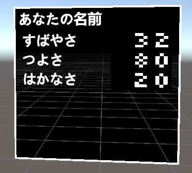

# Avatar Status Window Maker

## 概要

VRChatアバター用にゲームのキャラクターステータスウインドウみたいなやつを作るやつ

## インストール

### VCCによる方法

1. https://vpm.narazaka.net/ から「Add to VCC」ボタンを押してリポジトリをVCCにインストールします。
2. VCCでSettings→Packages→Installed Repositoriesの一覧中で「Narazaka VPM Listing」にチェックが付いていることを確認します。
3. アバタープロジェクトの「Manage Project」から「Avatar Status Window Maker」をインストールします。

## 使い方

AvatarStatusWindowMakerプレハブを突っ込んでよしなにする。

menuってやつをオンにするとメニューから数値が弄れるようになる。

[Compressed Parameters](https://github.com/Narazaka/CompressedIntParameters) (1.1.1以上) が入っていると、同期パラメーターのbit数を削減できます。

クソ雑注意書き:

- Floatパラメーターの精度的に数値のminとmaxが256以上離れていると1ずつ調整は出来ないです。
- 数字をシェーダーで書いてるのでデフォルトのアバターセーフティーだとTrustedでないと正しく表示されないです。

## Changelog

- 0.2.0:
  - Upload without pre-check等を使わずにアップロード出来るように
  - NDMF 1.8.0以上が必要になりました
  - ビルド後の数値表示オブジェクトの階層を変更（`AvatarStatusWindowMaker/Values/<ステータス名>`）
  - ビルド後にシーン上のマテリアルがmissingになる問題を修正
- 0.1.9:
  - Compressed Parametersと連携してパラメーター圧縮する機能を追加

## License

[Zlib License](LICENSE.txt)
